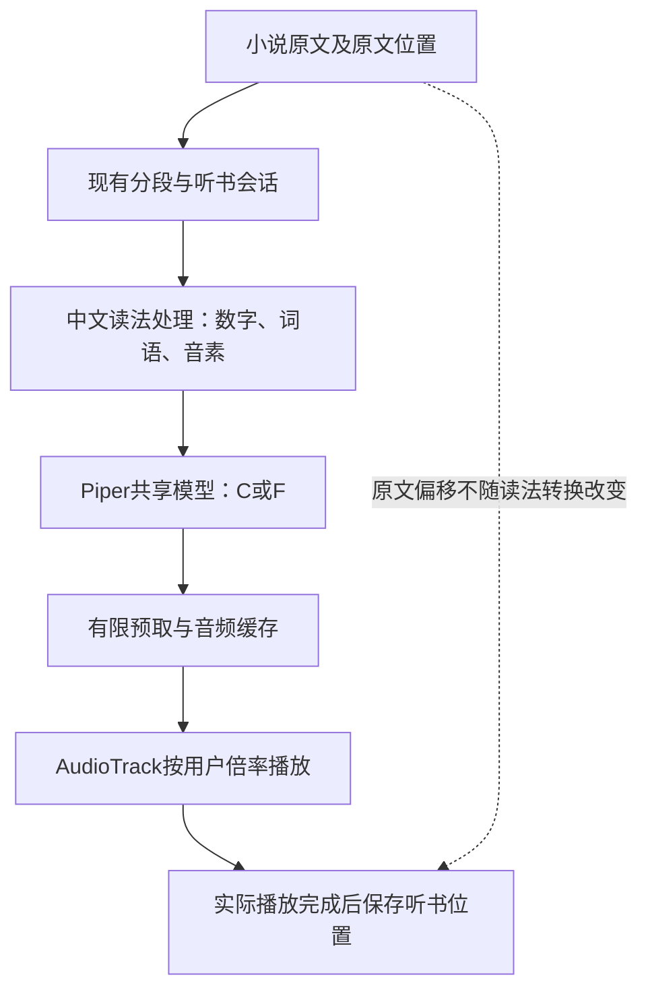

# Piper 替换 ZipVoice：听书体验与实现边界讨论

日期：2026-10-22。状态：**讨论整理，尚未实施；本文不是已批准的执行计划或验收结果。**

## 1. 本轮对象、资料与已确认需求

用户准备接入 Piper 替换 ZipVoice，要求将与侧面代理的讨论按项目流程落档，保留关键意见，并结合实际代码补全方案。本文整理产品边界、因果关系、风险与下一轮计划应回答的问题；本轮只修改文档，不启动接入、训练、设备测试或服务器作业。

代码与资料基线为 `feat-android-reader-foundation` 的 `61f9fc4`。生产实现仍是 ZipVoice，资源身份由[离线声音依赖](../../knowledge/offline-voice-dependencies.md)维护；声音筛选及本机计算初筛由[10月21日调查第14、15节](2026-10-21-offline-tts-landscape.md#14-10月22日现成piper六男声同文试听)维护。本次侧面讨论原文来自[用户附件](/Users/longshengxi/.codex/attachments/64bfec79-38f6-4016-8e08-a6a0e324d2a0/已粘贴的文本.txt)，关键内容已写入本文，不依赖附件长期存在才能接续。

用户已明确的方向：

- 核心需要是**离线、朗读通顺完整、计算消耗小、长听不明显发热**；免费、男声和尽量随 App 一体打包的偏好继续成立。
- 15 Ultra 和 17 Pro 在常用 1.45× 下均有发热及随发热出现失真的反馈。用户期待成熟的日常听书体验，不满足于“比以前凉一点”。
- 本轮六男声中的 C、F 初筛听感可以；这不是最终定选，也不等于长听耐听或新运行路径已验收。此处 C 是 SSB1020，**不是此前公开样音编号 C 的超文**。
- 准备沿 Piper 替换方向推进；可先用模拟器开发、验收，真机不在身边时后补，不必等手机才开始。
- 本次直接授权是整理讨论文档。C/F 双音色产品形态、默认声及具体中文前端是下文建议，不冒充已经确认的实现。

## 2. 判断与现有证据

**值得进入完整合成后端替换的计划阶段。** 已有计算差异足以支持投入候选开发，但最先要补齐自动中文朗读，而非继续扩大短句性能测试。需要依次回答：任意真实小说能否读好，C/F 是否耐听，完整链路能否把计算优势转成手机长听舒适度。

| 已有事实 | 可以支持的判断 | 还不能证明什么 |
| --- | --- | --- |
| 用户接受 C/F 的同文短样音；两声来自同一份社区 Piper AISHELL-3 模型 | 保留两声进入较长试听，共用适配工作，无需先训练 | 样音使用人工核对拼音，不能证明自动读法或连续听感 |
| 同 M1 Pro、sherpa 1.13.8、两线程、50字输入，三轮交替比较：C/F 同文热运行累计 CPU 较三步完整参考 ZipVoice 减少 71.5%／73.2% | 计算优势明显；按 1.45× 播放时长归一后仍有优势，值得接入评估 | 只用了41条固定词典；不是完整前端、手机耗电、温降或生产四线程基线比较 |
| 桌面适配已通过同版 sherpa 的正式 VITS/Piper 路径生成；改变的是元数据及输入资源，未训练权重 | 优先复用现有运行库 | 尚未证明 Android 资源准备、中文覆盖、取消行为和实际播放通过 |
| 旧版存在下一段已准备好仍发生交接延迟的记录 | 模型供给与播放交接必须分开判断 | 不能以换引擎自动关闭 [BUG-066](../../knowledge/bugs/BUG-2026-066-intermittent-audio-handoff-delay.json) |
| 用户报告热后失真，前序限定模拟器录音核听没有明显问题 | 新反馈仍需调查，旧证据按原条件保留 | 尚不能确认失真来自合成、倍速、播放、供给还是其他热态行为；[BUG-062](../../knowledge/bugs/BUG-2026-062-zipvoice-long-listening-thermal.json)未解决 |

不再重新推广超文、用户不接受的旧 Kokoro、先前未选用的 fanchen-wnj，以及撤回的 ZipVoice 两步、短参考和三线程路线。雷军声轻量训练保留为未实施后备方向，不混入当前替换候选。

## 3. 建议的产品形态与取舍

建议候选为：**一个内置离线 Piper 后端，一份共享模型，现有音色设置中提供 C/F 两个经过筛选的声音，复用当前听书操作。** 不展开174个说话人，不长期维护 ZipVoice/Piper 双引擎，也不在失败时自动切回 ZipVoice。

| 试听编号 | 发音人／模型 SID | 建议身份 |
| --- | --- | --- |
| C | SSB1020／30 | 候选声音；可暂作试用默认，尚非用户最终选择 |
| F | SSB0863／151 | 候选声音，与 C 同等参加耐听检查 |

音色持久化标识应包含模型系列与发音人身份，稳定映射到 SID，不能只保存易混淆的 C/F 或裸编号。界面名称保持能对应试听的准确称呼，不暗示它是雷军或真人录音。具体名称和试用默认是可调整的建议；最终默认优先依据完整路径的耐听反馈，不按几十毫秒生成差异决定。

这项选择暂时放下雷军参考声音及克隆能力，换取固定声音的较低计算路径。免费离线、内置资源、现有阅读／听书交互继续保留。若 C/F 较长试听不过关，应在这一步停下归因或更换声音，不能因为计算数据好就强行交付。

不纳入音色商城、下载管理平台、训练流水线、在线生成、系统 TTS 依赖、NPU 重构、阅读器重写或存储格式迁移。仅删除未运行的旧代码本身不会明显降温；实际收益来自新推理路径及其调度，清理主要减少包体、混用风险和维护负担。

## 4. 替换范围与完整处理关系

| 部分 | 建议处置 | 必须核对的边界 |
| --- | --- | --- |
| 阅读入口、会话、通知、焦点、定时、位置保存 | 保留职责和已有交互 | 新开从当前显示正文起读，暂停继续原会话，停止后旧任务不复活；阅读与听书进度仍各自准确 |
| 中文前端 | 先完成兼容该模型的自动处理方案 | 不把手工拼音或小词典升级成“任意小说支持”；见第5节 |
| 合成后端 | 替换 ZipVoice 初始化与生成接线 | 移除参考 WAV／文字、三步等专属参数、独立 Vocos 接线；按 Piper 模型实际采样率和参数输出 |
| 有限预取、播放和取消 | 优先复用现有实现，改必要接缝 | 新旧声音缓存隔离，过时结果丢弃；检查模型返回后实际播放，不能仅看生成成功 |
| sherpa-onnx | 优先沿用1.13.8 | 桌面可行不代替 Android 验证；无证据不升级或自编运行库 |
| 资源准备、设置、UI及相关测试 | 随候选一起更新 | APK只打包所需模型／前端资源，旧值正确映射，选择与实际发声一致，测试不再固定断言雷军 |

“移除 ZipVoice”指应用对它的专属实现、配置与打包资源。共享 AAR 内未使用的 ZipVoice 支持代码不必为此单独裁剪；不将删除旧后端扩大为重做通用推理库。

本次静态核对的实际入口：

- [OfflineReaderTtsEngine](../../../app/src/main/java/com/longerlsx/storyapp/feature/reader/tts/OfflineReaderTtsEngine.kt)：ZipVoice 初始化、参考资源、四线程／三步、数字转换、AudioTrack、取消与释放目前在同一实现中，需要按职责替换。
- [ReaderSettingsStore](../../../app/src/main/java/com/longerlsx/storyapp/data/reader/ReaderSettingsStore.kt) 与 [ReaderTtsSettings](../../../app/src/main/java/com/longerlsx/storyapp/core/model/ReaderTtsSettings.kt)：读取时强制默认 `zipvoice:leijun`；引擎 `applySettings` 也强制默认。仅增加菜单不能完成换声。
- [ReaderTtsAudioPreparation](../../../app/src/main/java/com/longerlsx/storyapp/feature/reader/tts/ReaderTtsAudioPreparation.kt)：已有最多两段预取，缓存键已含正文、音色和合成速度；[ReaderTtsService](../../../app/src/main/java/com/longerlsx/storyapp/feature/reader/tts/ReaderTtsService.kt) 已在音色／速度变化时刷新后续准备。应核对并复用，不能把“缓存没有音色身份”写成现存缺陷。
- [app/build.gradle.kts](../../../app/build.gradle.kts) 打包整个 `.local-tts/assets`；[准备脚本](../../../scripts/prepare-offline-voice.sh) 目前只准备 ZipVoice。只改引擎调用不会自动排除旧模型。

## 5. 中文前端是第一个实际可用性关口

优先评估成熟、与本模型音素规则兼容的词典和规则，再用真实小说判断是否足够。已有 sherpa 词典路径不等于必须加载 G2PW 神经网络；也不能反过来认定一个小词典的低成本代表完整中文前端成本。具体来源、版本、音素映射和支持范围应在计划中落定，候选实施后进入声音依赖文档。

需核对数字、时间、年份、常用多音词、人名、生僻字、引号对话、中英混排、长短句和章节边界。原有数字规范化实现因 ZipVoice 缺口而加入，但**读对数字仍是产品要求**；新方案必须明确由哪一层负责，避免重复转换或漏处理。模型参数、音素 ID、边界符及标点的处理要与选中权重一致，不能把能返回 WAV 当成适配成功。

除固定回归语句外，应保留未参与前端调试的真实正文，完成方案后直接检查。常见词反复错读、吞字、跳过数字／英文或句尾缺失应阻止候选通过；偶发生僻人名读音不理想记录位置与影响后判断，不宣称通用完美读音。词典未命中必须有明确处理与内容核对，不能静默省略后用更短的输出声称更快。若成熟方案仍有重要缺口，再决定补通用规则／词典还是引入更复杂前端，不逐句添加验收专用词条。

**未命中与失败不能变成已读进度。** 词语未命中可采用经过验证的离线逐字读法；对前端已检测到仍无法处理的可读正文，不得静默丢弃、只播放剩余部分后确认整段完成。无法生成有效音素、空音频或合成异常时，沿用现有错误提示与可重试路径，保留该段的可恢复位置，不自动跳过或无限重试。明确允许清洗的非朗读符号另行区分。上述处理不意味着运行时已经能够发现所有模型漏读：非空音频仍需通过代表正文的实际内容核对。

原文位置贯穿整条链路。例如把“48小时”转为“四十八小时”只影响合成输入，保存与恢复仍指向原文范围；进度只在实际播放完成时确认，不能按转换后字数或生成完成提前推进。

## 6. 音色、速度、预取与用户中断

**设置与缓存一起改通。** C/F 使用稳定标识；旧雷军、历史音色、空值及无效值映射到候选默认，保留其他设置。模型只加载一份，切换 SID 不应建立双引擎。换声后未取用的预生成音频应换为新声，正在进行的过时生成即使不能立即中断，也不能在稍后覆盖新状态或播放。

建议延续当前参数快照节奏：已经取用、正在准备或播放的当前语音单元完成后，后续单元使用新设置，不突然截断当前句。这里是生产分段的“语音单元”，不保证等于整个自然句。还须覆盖快速 C→F→C、主动暂停期间换声、临时失焦保留音轨后恢复、试听结束回正文及重启后的选择；这些是相同状态交接的代表情况，不展开所有组合。暂停／焦点规则按现有产品契约执行，不能仅因音色切换擅自播放。

**第一轮保留自然1×合成、播放端调速与独立音调。** 这样改速可继续复用自然语音缓存，减少同时变化的因素。Piper 原生速度不是禁用路线，但应留给有依据的后续比较；若采用，必须同步更改生成身份、缓存与预取时长，避免再次叠加播放倍率。ZipVoice 特定的原生加速截尾原因不能直接套到 Piper。

**继承体验约定，重新判断旧参数。** 当前极短首段会等待较长第二段准备好再发声，已用首次等待换掉一次断供；Piper 下可能仍有价值，也可能多等了。应通过正常冷启动的实际首声和两段衔接判断，既不无条件永久保留，也不先删后猜。ZipVoice 四线程、桌面对比两线程、内部最小字数和静音参数都不是最终 Piper 手机配置；先按模型和供给证据选简单基线，不同时展开多参数优化。

低计算必须最终留出空闲时间。接入后关注重复生成、过时任务、无用预取和停止后的释放；不提前合成全书，不因单次更快就扩大缓存或常驻更多模型。保留已有任务身份、取消与释放边界，核对 Piper 原生调用的实际取消粒度，不承诺点击停止能中断一次正在运行的 ONNX 运算。

**完整路径补一次成本核对。** 41条测试词典的初筛不能直接覆盖正式中文前端。前端与正式分段接通后，复用已有计时／CPU采集方式，在同一环境用代表正文核对首次准备、后续生成的累计CPU与耗时、实际音频时长和1.45×播放预算，确认没有因前端、断句或重复工作引入明显的新负担；不只看孤立模型调用或最快一段。此项用于发现接入退化，不在模拟器上发表手机节电结论，也不另建性能矩阵。若要据此声明相对ZipVoice的具体改善比例，再进行匹配条件下的成对比较。

## 7. 资源、升级与回退在候选阶段闭合

采用侧面讨论的**后文修正**：候选实施时即可清理旧产品路径，无须把全部旧代码清理延后到真机通过。它早先“模拟器只打包 Piper、真机通过后再清理旧实现”的安排不作为最终建议。清理与回退完整、手机低热成立是两个独立完成条件。

候选应具备：

1. 可重复的资源准备：模型、音素表、词典和必要规则固定来源／版本／摘要；适配后模型身份也可追溯。APK只包含需要的声音资源，不能把约77.64MB声学文件当作整套方案包体。
2. 首次完全离线：新安装、断网，导入此前没有合成过的新正文并正常朗读，不依赖预生成音频、首次下载或另装语音服务。
3. 精确清理：区分仓库打包目录、开发机下载缓存、手机可重建的语音资源与用户书籍／设置／进度。只清理明确归属且可恢复的旧语音资源，不清空整个应用私有目录。旧 APK 能从自身资源重新准备所需文件，须实际验证。
4. 可用回退：保留同签名基线 APK、对应提交和可复现资源。建议以[当前状态页记录的10月16日体验候选](../../current-state.md)（代码 `6ada54c`）固定旧版目标，沿用其已知限制，不能改称“无缺陷版本”。资源清理前先确保这条回退路径仍可使用。
5. 数据连续性：默认不改存储格式。模拟器走“旧版产生数据 → 覆盖候选 → 继续读听并产生新进度／设置 → 覆盖旧版重新打开”，核对原文、书籍身份、阅读／听书位置及非音色设置。仅恢复候选前备份不算通过；Git 回退也不等于应用数据回退。

**回退音色的实际例外：** 旧版只能播放雷军，会把 C/F 值在内存中归为默认；后续保存设置可能将其写回为雷军。再升级候选时按映射回到候选默认，不承诺旧版替新版本记住 C/F 选择。这不应影响书籍、其他设置或候选新增进度；用上述往返路径确认。无需为保留一次试用音色偏好新增存储迁移或双引擎。

## 8. 从真实听书角度验收，模拟器与手机分开

所有体验验收从正常 App 入口开始，经过生产分段、中文前端、预取、会话和播放。直接调用模型可作兼容诊断，但不能替代实际听书验收。沿用[10月16日计划第3节](../plans/2026-10-16-app-experience-stability.md#3-验证标准尤其是听书验收)已有录音、核听和停顿归因方法，按受影响路径选验证，不机械重跑全部历史任务。

### 模拟器：开发与候选交付

建议继续使用 `StoryReader_API34`。先接通完整中文前端及最小正式路径，再由同一路径给 C/F 各取得约5–10分钟真实小说播放录音，优先1.45×，辅以1×内容检查。两个声音共用模型与调用链，功能回归以选中的代表声为主，另一个覆盖换声和实际音质，避免重复整套矩阵。

| 要回答的问题 | 最小直接证据与判断 |
| --- | --- |
| 新小说读得通顺完整吗 | 固定短样本与未参与调试的正文，逐段对应原文；检查多音字、数字／英文、对话及边界。转写辅助找错，不能代替核听或证明无失真 |
| C/F 是否适合持续听 | 听完整前端产生的较长录音，记录喉音／齿音、单调腔调、对话停顿、段间音量和疲劳感；保留失败，不挑最好一次。无法可靠听辨时标待核听 |
| 冷启动是否自然衔接 | 确认旧进程结束、不预热，正文由正式规则自然分出“短首段→长第二段”；同时记录点击、首声、第二段生成和播放，不能等第二段好了才观察 |
| 连续播放是否稳定 | 保留真实时间间隔的实际播放录音，与生成／播放日志对齐。沿用内部低电平≥0.6秒逐项调查口径，区分合成停顿、操作／焦点、采集故障和意外等待；短而反复可感知的卡顿也处理。无解释告警不能以进度增长通过 |
| 中断是否符合意图 | 串联准备中暂停／停止、重新开始、播放中改速／换声、浏览／换章、模式切换、熄屏、焦点／通知、主动暂停继续、定时结束及退出再进；核对实际声音、画面、控件和源位置，不每步都等稳定才操作 |
| 能否持续使用、恢复与回退 | 最终候选至少一次15分钟正式播放，包含跨章、熄屏及定时停止，保留完整音轨并核听首中尾、边界及异常；实际进程结束再启动不擅自播放。另走第7节升级／回退路径 |
| 是否真正离线与完成清理 | 首装断网读新文，检查 APK 资源及准备结果；旧语音数据清理不伤书籍和进度，回退仍能重建依赖 |

录音先用已知发声和明确暂停校准；不能用省略空闲时间的 WAV 后端或拼接音频证明连续性。卡死保护只证明没有长期停住，不能代替上述声音与停顿判断。若发生异常，用相同原文片段的生成 PCM 对照实际播放，再决定修合成还是播放；既有 BUG-066 不因换模型或新窗口通过自动关闭。

模拟器阶段可交付同签名 ARM64 候选 APK、实际播放录音、身份与验证摘要。完成表述应为：**“可供真机试用的 Piper 听书候选，开发与模拟器功能验收完成；温耗和热态音质待真机验证。”** 只有对应证据齐全才能使用这句话，当前仍未开发。

### 真机：长期舒适度与热态声音

手机方便后再做。先选一个声音、一台手机比较，通过后补另一台，避免两声×两机×全部设置的矩阵。使用同环境、相近初温、不充电、同输出方式／音量和同正文，主要测1.45×熄屏连续听，补边看边听；建议30–60分钟，至少覆盖此前出现问题的时间。旧版与候选使用可比构建并记录差异，不将前序Mac两线程初筛直接当手机对照。

关键是用户愿意这样持续听，握持不因发热明显不适，后半程不持续恶化，声音不随发热失真或断续。温度、生成速度／余量、CPU与电荷记录解释过程，观察后半程趋势；电荷计读数不可靠时不报节电比例。保留实际播放录音并定位热态异常，耳机／扬声器、小米后台行为单独说明覆盖条件。

若需发表具体性能改善结论，再依项目规则安排同设备、同输入、同类构建至少三组成对交替比较。先做有效试用判断，不为凑温降百分比提前扩大长测。一次“略凉”、模拟器长听顺畅或生成快都不足以宣称根本目标达成；即使模拟器候选完成，手机长听核心目标仍保留未结项。

## 9. 因果链、下一轮顺序与停止线

本轮机会是：**生成负担下降 → 1.45×实际播放有更多供给余量 → 处理器可能更早完成并空闲 → 持续功耗与发热有望下降。** 完整前端、线程等待、过时生成、预取与播放都可能损耗收益，不能把其中一项 CPU 降幅换算成手机节电或降温比例。声音本身合格和播放稳定需要各自证据，低 CPU 不替代任一项。

下一轮计划建议顺序为：

1. 落定单引擎候选边界及完整中文方案，先验证未见正文；不先扩展性能矩阵或训练。
2. 通过最小正式路径生成 C/F 较长样音，确认内容与耐听性；有重要缺陷先归因，避免完成全部集成后才发现声音不可用。
3. 完成设置、预取／取消、资源与旧路径清理，核对完整路径成本，补受影响控制、离线、升级回退及模拟器持续播放，交付可试用候选。模拟器内已证实的首声等待、供给和控制问题在本阶段处理，不为等待真机而推迟；没有新证据则保留简单基线。
4. 手机可用时完成长听舒适度、生成余量和热态声音判断，依据手机证据决定是否进一步调整线程／首段等待或研究原生速度。模拟器选出的参数仍是候选配置，不能据此预先定为手机最优。

计划应将替换作为一个完整但有边界的任务：先固定不变量和直接证据，普通实现取舍自主处理，复用现有测试与日志，按授权分步中文提交／推送；共享构建与设备操作串行，一次性验收代码预算按[协作约定](../../knowledge/agent-operating-agreements.md)写入计划。无需创建新监控或测试框架，也不将所有阅读回归重做一遍。

当前三个主要实证未知是**自动中文前端能否支持真实小说、C/F 是否耐听、手机是否达到长听舒适目标**。C/F 试用默认和最终命名是可调整选择；资源清理、参数身份、缓存和回退属于必须主动做完整的实现责任，不再逐项交回用户补方案。

重要读法或声音缺陷不过关就停在前面；模拟器通过后停止扩查并交付候选，手机结论单独保留。若手机仍发热失真，应按已记录音轨／日志定位下一步，不能以“引擎替换完成”关闭用户的根本问题。

## 10. 本次整理记录

已完整阅读附件并核对上述代码入口；保留了六项用户体验意见、模拟器先行的用户要求、五个架构遗漏及后文纠正的清理时机。主代理补充了当前缓存已含音色身份、参数按语音单元取快照、C编号避免与超文混淆、回退旧版不能保留新音色选择等边界。

本次仅新增讨论稿并更新阅读入口／当前状态；检查文档链接、身份、建议与事实的一致性及差异，无产品实现、构建、设备、声音或温耗新验收。生产依赖页继续描述 ZipVoice，待实际替换后再更新，不将讨论提前写成现状。

2026-10-22侧面复核：主体与讨论一致；补充已检测到不可读正文的失败／恢复边界、完整前端接入后的轻量成本核对，以及模拟器已证实问题应在候选阶段处理的顺序。仅修改本文，不改变用户确认范围，不启动产品接入或新增验收结论。
